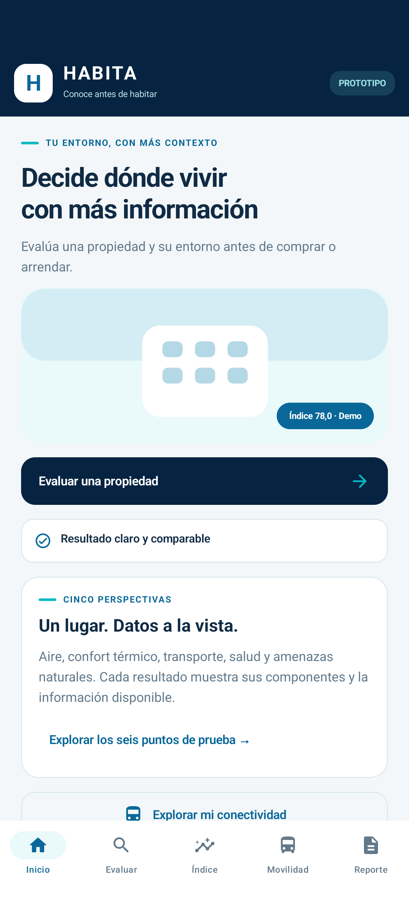
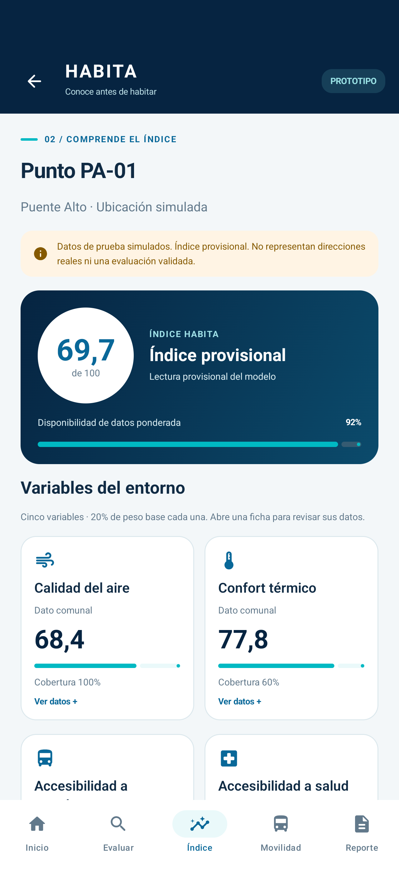
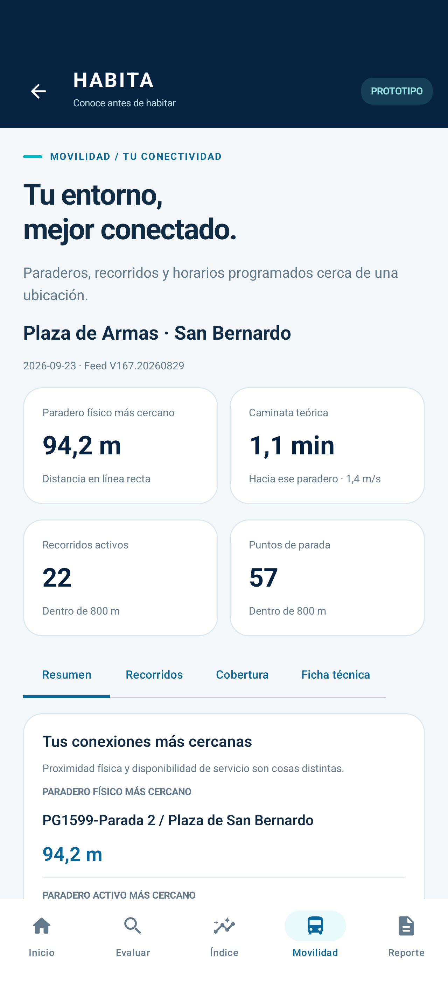
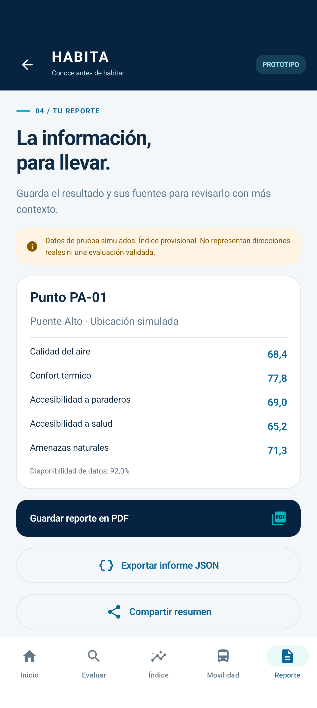

# Validación de HABITA Android

Comprobaciones realizadas el **20 de octubre de 2026**, en la rama local `cristian/prototipo-movil`.

- **Compilación debug:** correcta, con Gradle 8.13, Android Gradle Plugin 8.13.2 y JDK 21.
- **Android Lint:** pasa, sin errores. Mantiene avisos de disponibilidad de versiones más recientes y recomendaciones de estilo/configuración; no se ocultaron mediante un baseline.
- **Núcleo Kotlin:** 11 pruebas aprobadas. Incluyen los seis índices de demostración, ausencias y pesos, validación numérica, horas GTFS, dos comparaciones completas contra informes Python v1.2.1 y cuatro pruebas de reglas con feeds sintéticos.
- **Android:** 5 pruebas distintas aprobadas en un emulador aislado Android 17 / API 37.1. El recorrido de interfaz se verificó en una ejecución de 3 pruebas; la importación y restauración se verificaron en otra ejecución de 2 pruebas.
- **Capturas:** seis vistas reales de la aplicación, revisadas visualmente. No son imágenes de Figma ni maquetas HTML.

## Evidencia funcional

La consulta nativa de Plaza de Armas de San Bernardo del **23/09/2026** informa el paradero PG1599 a **94,2 m**, **22 recorridos activos** y **57 puntos de parada** dentro de 800 m. Las pruebas JVM comparan además todo el desglose de la parada activa y de ambos radios con los JSON originales del equipo, incluyendo intervalos y viajes únicos, tanto en San Bernardo como en Estadio Nacional.

La navegación seleccionó **PA-01**, mostró **69,7** y **92% de cobertura**, conservó el punto al recrear la actividad y llegó a detalle y reporte. Se verificó la generación de bytes PDF válidos. Para una consulta real de transporte se comprobó que el índice tiene **20% de cobertura** y que calidad del aire sigue sin puntaje.

Las pruebas de importación verifican que un ZIP con cabecera inválida en `stop_times.txt` se rechaza sin cambiar la fuente seleccionada, que un ZIP válido persiste al recrear el repositorio y que se puede restaurar el feed incluido.

## Capturas

| Inicio | Índice |
|---|---|
|  |  |

| Movilidad | Reporte |
|---|---|
|  |  |

También se conservan [Evaluar](capturas/evaluar.png) y [Detalle](capturas/detalle.png).

## Límites de esta verificación

La búsqueda mediante Geocoder está implementada con las APIs Android correspondientes, pero no se verificó la respuesta de un proveedor remoto de direcciones. Su disponibilidad y conexión se comprueban al utilizarla. Los selectores de documentos, la elección de una aplicación externa de mapas y la hoja para compartir deben completarse en el dispositivo que los utilice.

La compatibilidad con API 26 se comprueba mediante compilación y Lint; la ejecución instrumentada se realizó en API 37.1. Esta validación no equivale a una prueba física en todas las versiones Android ni a una validación científica del Índice HABITA.

## Repetir las comprobaciones

```powershell
.\gradlew.bat :core:test :app:assembleDebug :app:lintDebug
.\gradlew.bat :app:connectedDebugAndroidTest
```

Las bibliotecas de pruebas se fijaron en AndroidX Test Runner 1.7.0, JUnit AndroidX 1.3.0 y Espresso 3.7.0 para resolver una incompatibilidad de reflexión de la versión anterior con Android 17. [Notas oficiales de AndroidX Test](https://developer.android.com/jetpack/androidx/releases/test).

El proyecto incluye el código Kotlin, las pruebas, las capturas y el Gradle Wrapper. Los datos GTFS se toman de las nueve partes ya versionadas en la carpeta hermana del repositorio. Consulta el [README](../README.md) para abrirlo desde un clon del repositorio del equipo.
