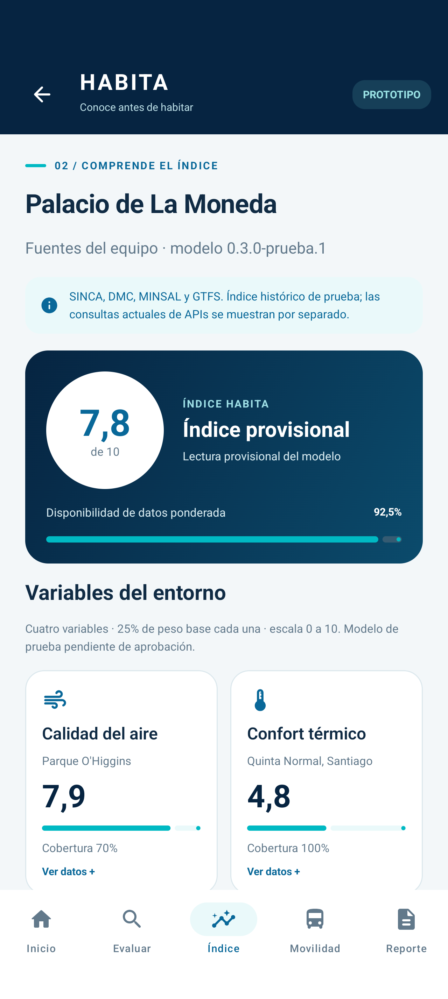
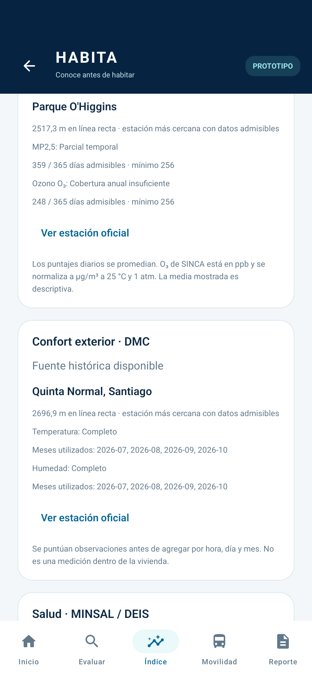
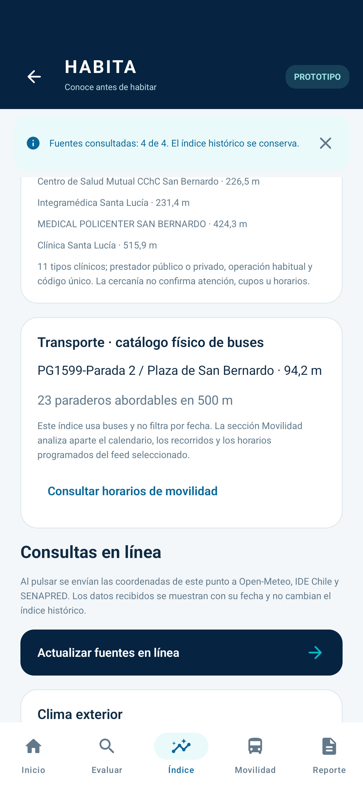

# Validación de HABITA Android

## Comprobación previa a la publicación del 22 de octubre de 2026

Se comprobó nuevamente `:core:test :app:assembleDebug :app:lintDebug` con resultado **BUILD SUCCESSFUL**. Las tareas de pruebas conservan sus resultados vigentes: **19 pruebas Kotlin/JVM**, sin fallos. Gradle verificó el SHA-256 del catálogo y generó el APK debug. Esta comprobación no repite las pruebas de emulador ni las consultas de APIs realizadas el 21 de octubre y documentadas abajo.

## Actualización del 21 de octubre de 2026

Versión Android **0.2.0**, preparada sobre `main` en `e075fd4fd0a4c893f419ea3b7baec09aa878f38f`. La rama de desarrollo es `kr0us`.

- **Build y Android Lint:** correctos. Se generaron los APK de la app y de instrumentación. Lint conserva recomendaciones de versiones/estilo; no hay errores bloqueantes ni baseline nuevo.
- **Kotlin/JVM:** **19 pruebas aprobadas**, sin fallos. Incluyen las 11 anteriores, equivalencia del modelo geográfico con las ocho ubicaciones Python y pruebas de cobertura, coordenadas, unidades, ceros, catálogos truncados, duplicados e interpretación de amenazas sin puntaje inventado.
- **Fuentes Python:** **26 pruebas aprobadas**, sin cambiar sus fórmulas. Se ejecutaron con Python y openpyxl del entorno, usando una carpeta temporal del proyecto por restricciones de escritura de Windows.
- **Android:** **7 pruebas aprobadas en una ejecución final**, en un emulador QA independiente Android 17 / API 37.1. Incluyen demo y rotación, error legible de coordenadas, GTFS completo, importación/restauración, índice real de cuatro variables, persistencia, PDF y fuentes online.
- **APIs desde Android:** las cuatro respondieron correctamente: Open-Meteo Weather, Open-Meteo Air Quality/CAMS, MINSAL/IDE Chile WFS y SENAPRED volcánico. Se comprobó que la consulta no cambia el puntaje histórico. Es evidencia de la ejecución; no garantiza disponibilidad futura del proveedor.
- **Integridad:** **162 archivos fuente** contrastados contra el SHA-256 del catálogo preparado, sin diferencias. Los 16 Excel de las dos carpetas renombradas conservan sus blobs originales. El catálogo de 2.358.759 bytes tiene SHA-256 `fe85427b56b4fce09f2e7c2345a7b45dd5daf71ab8269aeb6907f51a32b8446b`.

El entorno de prueba se creó dentro de `build/qa-avds` y se cerró al terminar. No se instaló ni ejecutó la batería de pruebas en el emulador del usuario que ya estaba abierto.

### Comprobaciones funcionales nuevas

La Moneda: índice **7,8 / 10** al redondear a un decimal y **92,5%** de disponibilidad ponderada. El aire selecciona Parque O'Higgins y conserva la ausencia de O₃ por cobertura anual insuficiente (248 días, por debajo de 256); confort selecciona Quinta Normal. Kotlin coincide con el programa Python para este punto y los otros siete ejemplos, incluidos los componentes y distancias.

San Bernardo: el índice histórico es **7,9740641268 / 10**, con 100% de componentes disponibles. La prueba de APIs conservó ese valor; consultó temperatura y humedad exterior, concentraciones de aire modeladas, establecimientos del catálogo WFS y la intersección volcánica. La respuesta WFS informó **15 centros admisibles en 2 km**. La capa volcánica no devolvió intersecciones para ese punto; esto no equivale a ausencia de riesgo.

Se verificó que editar la coordenada marque el resultado anterior y deshabilite actualizar sus APIs hasta volver a analizar, que el índice del entorno se persista en almacenamiento privado y que JSON/PDF incluyan las fuentes y el modo. La prueba GTFS fija explícitamente San Bernardo para no heredar la ubicación de otro ensayo.

### Capturas de la aplicación actualizada

| Índice histórico | Estaciones de referencia | Confirmación de consultas |
| --- | --- | --- |
|  |  |  |

Ver [decisiones y límites de integración](INTEGRACION_FUENTES.md) y [cómo ejecutarlo](../README.md). El nuevo modelo sigue siendo una propuesta de prueba. Amenazas de inundación, fallas y remociones, el geocodificador remoto y la conexión a un sensor IoT no se dan por validados por estas pruebas.

## Evidencia de la versión anterior

Comprobaciones realizadas el **20 de octubre de 2026**, en la rama local `cristian/prototipo-movil`.

- **Compilación debug:** correcta, con Gradle 8.13, Android Gradle Plugin 8.13.2 y JDK 21.
- **Android Lint:** pasa, sin errores. Mantiene avisos de disponibilidad de versiones más recientes y recomendaciones de estilo/configuración; no se ocultaron mediante un baseline.
- **Núcleo Kotlin:** 11 pruebas aprobadas. Incluyen los seis índices de demostración, ausencias y pesos, validación numérica, horas GTFS, dos comparaciones completas contra informes Python v1.2.1 y cuatro pruebas de reglas con feeds sintéticos.
- **Android:** 5 pruebas distintas aprobadas en un emulador aislado Android 17 / API 37.1. El recorrido de interfaz se verificó en una ejecución de 3 pruebas; la importación y restauración se verificaron en otra ejecución de 2 pruebas.
- **Capturas:** seis vistas reales de la aplicación, revisadas visualmente. No son imágenes de Figma ni maquetas HTML.

## Evidencia funcional

La consulta nativa de Plaza de Armas de San Bernardo del **23/09/2026** informa el paradero PG1599 a **94,2 m**, **22 recorridos activos** y **57 puntos de parada** dentro de 800 m. Las pruebas JVM comparan además todo el desglose de la parada activa y de ambos radios con los JSON originales del equipo, incluyendo intervalos y viajes únicos, tanto en San Bernardo como en Estadio Nacional.

La navegación seleccionó **PA-01**, mostró **69,7** y **92% de cobertura**, conservó el punto al recrear la actividad y llegó a detalle y reporte. Se verificó la generación de bytes PDF válidos. Para una consulta real de transporte se comprobó que el índice tiene **20% de cobertura** y que calidad del aire sigue sin puntaje.

Las pruebas de importación verifican que un ZIP con cabecera inválida en `stop_times.txt` se rechaza sin cambiar la fuente seleccionada, que un ZIP válido persiste al recrear el repositorio y que se puede restaurar el feed incluido.

## Capturas

| Inicio | Índice |
|---|---|
|  |  |

| Movilidad | Reporte |
|---|---|
|  |  |

También se conservan [Evaluar](capturas/evaluar.png) y [Detalle](capturas/detalle.png).

## Límites de esta verificación

La búsqueda mediante Geocoder está implementada con las APIs Android correspondientes, pero no se verificó la respuesta de un proveedor remoto de direcciones. Su disponibilidad y conexión se comprueban al utilizarla. Los selectores de documentos, la elección de una aplicación externa de mapas y la hoja para compartir deben completarse en el dispositivo que los utilice.

La compatibilidad con API 26 se comprueba mediante compilación y Lint; la ejecución instrumentada se realizó en API 37.1. Esta validación no equivale a una prueba física en todas las versiones Android ni a una validación científica del Índice HABITA.

## Repetir las comprobaciones

```powershell
.\gradlew.bat :core:test :app:assembleDebug :app:lintDebug
.\gradlew.bat :app:connectedDebugAndroidTest
```

Las bibliotecas de pruebas se fijaron en AndroidX Test Runner 1.7.0, JUnit AndroidX 1.3.0 y Espresso 3.7.0 para resolver una incompatibilidad de reflexión de la versión anterior con Android 17. [Notas oficiales de AndroidX Test](https://developer.android.com/jetpack/androidx/releases/test).

El proyecto incluye el código Kotlin, las pruebas, las capturas y el Gradle Wrapper. Los datos GTFS se toman de las nueve partes ya versionadas en la carpeta hermana del repositorio. Consulta el [README](../README.md) para abrirlo desde un clon del repositorio del equipo.
